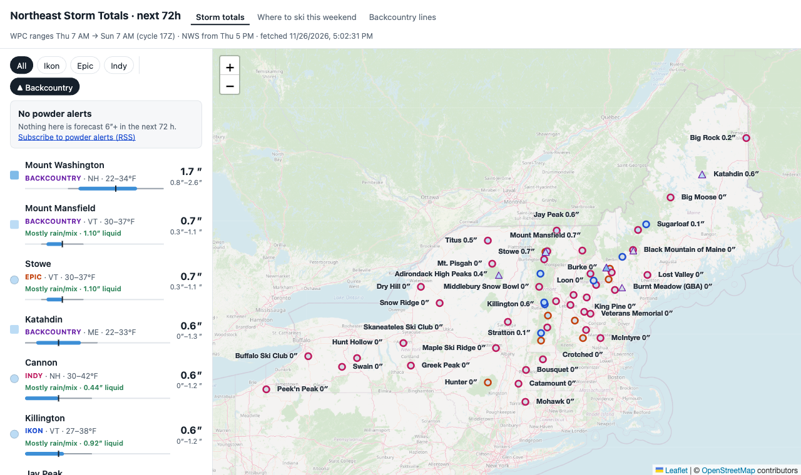
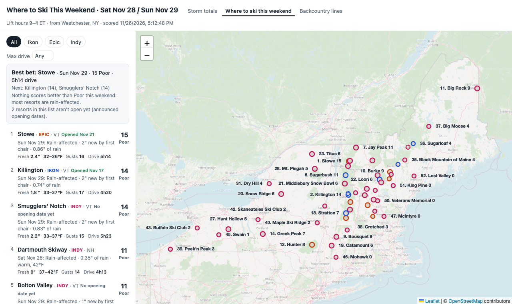
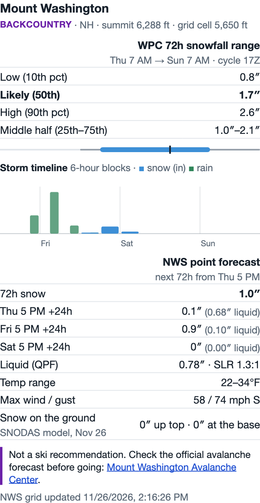
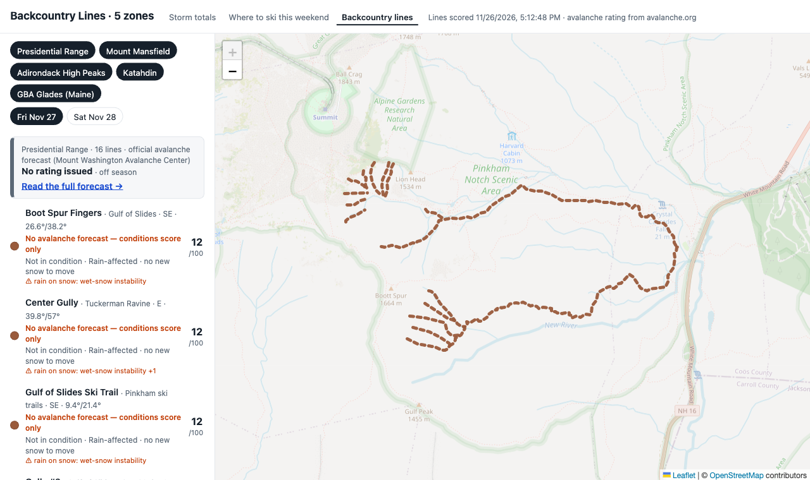
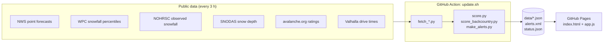

<h1 align="center">Northeast Snow</h1>

<p align="center">
  <b>Where's the snow, where should I ski this weekend, and is that backcountry line in?</b><br>
  A free snow map for New York and New England, rebuilt from public weather data every 3 hours.
</p>

<p align="center">
  <a href="https://tpkfounder.github.io/northeast-snow/"><b>Open the live site →</b></a>
  &nbsp;·&nbsp;
  <a href="https://tpkfounder.github.io/northeast-snow/data/alerts.xml">Powder alerts (RSS)</a>
  &nbsp;·&nbsp;
  <a href="CHANGELOG.md">What's new</a>
</p>

<p align="center">
  <a href="https://github.com/Tpkfounder/northeast-snow/actions/workflows/update.yml"></a>
  
  
  
  
</p>



## What it does

| | |
|---|---|
| **❄️ Storm totals** | Next-72-hour snowfall for every mountain as a *range* (low / likely / high from NOAA's probabilistic forecast), not a single number. Each popup has an hour-by-hour **storm timeline** of snow vs rain, and the modeled **snow already on the ground**. |
| **🎿 Where to ski this weekend** | Ranks **54 Ikon, Epic and Indy resorts** by snow conditions × wind-hold risk × drive time. Filter by pass and maximum drive, see a **best bet** summary, and skip resorts that **aren't open yet**. |
| **⛰️ Backcountry lines** | **30 curated lines in 5 zones**: Presidential Range, Mount Mansfield, Adirondack High Peaks, Katahdin and Granite Backcountry Alliance glades. Scored daily for fresh snow, coverage, wind loading and surface, and **gated by the official avalanche forecast**. Each zone toggles on and off. |
| **🔔 Powder alerts** | An RSS feed of anything forecast 6"+ in the next 72 hours. Subscribe in a feed reader, or send it to email with a service like Blogtrottr. |

<table>
  <tr>
    <td width="62%"></td>
    <td width="38%"></td>
  </tr>
  <tr>
    <td><sub>Where to ski this weekend: ranked, filterable, honest when nothing is good.</sub></td>
    <td><sub>Every mountain: range, storm timeline, snow on the ground.</sub></td>
  </tr>
</table>



## The backcountry safety rule

This site **never says "go ski this."** The best a line can ever read is *"looks in condition, pending the avalanche forecast"*, and every line shows and links the official avalanche danger rating.

- At **Considerable (3) or higher**, lines are greyed out and get no score.
- Where no avalanche center forecasts a zone (Vermont, the Adirondacks, Katahdin, the Maine glades), every line permanently reads **"No avalanche forecast — conditions score only"**.

A snow score isn't a stability assessment. Avalanche terrain needs training, partners, rescue gear and the day's forecast.

## How it works



A scheduled GitHub Action runs `update.sh` from 5 am to 10 pm Eastern. The Python scripts fetch and score everything into small JSON files, and a static page (Leaflet map, no build step, no server) reads them. If a source fails, the page says which one; if the data goes more than 8 hours stale, it warns.

## Data sources

| What | Source |
|---|---|
| Point forecast (snow, rain, temperature, wind) | [NWS gridpoint API](https://www.weather.gov/documentation/services-web-api) |
| Snowfall ranges (10th–90th percentile) | [WPC Probabilistic Precipitation Portal](https://www.wpc.ncep.noaa.gov/pwpf/) |
| Observed and season-to-date snowfall | [NOHRSC National Snowfall Analysis](https://www.nohrsc.noaa.gov/snowfall/) |
| Snow depth on the ground (modeled) | [NOAA SNODAS via NSIDC](https://nsidc.org/data/g02158) |
| Avalanche danger | [avalanche.org](https://avalanche.org) public API |
| Drive times (cached) | [Valhalla](https://valhalla1.openstreetmap.de) on OpenStreetMap data |
| Backcountry line geometry | [OpenStreetMap](https://www.openstreetmap.org/copyright) (ODbL) |
| Slope, aspect and elevation | [USGS 3DEP](https://www.usgs.gov/3d-elevation-program) lidar |
| Season opening dates (weekly snapshot) | [snowpack.report](https://snowpack.report/opening-dates), which links each resort's own announcement |
| Resort websites and snow reports | Each resort's site; Indy links from [indyskipass.com](https://www.indyskipass.com/our-resorts) |

## Limitations

- **Forecasts, not guarantees.** Ranges show the uncertainty; trust the middle less when the range is wide.
- **Snow depth is modeled natural snow.** SNODAS doesn't know about snowmaking or grooming, so resort bases will usually be deeper.
- **Opening dates are a weekly snapshot,** not live lift status. Always check the resort's snow report (linked in every popup).
- **Drive times are free-flow.** Weekend ski traffic is often 20–40% slower.

## Project layout

```
config/
  mountains.json            tracked mountains: weather point, base for driving, pass
  resort_info.json          resort website, snow-report link, opening date (snapshot)
  scoring.json              weekend-score weights
  backcountry/<zone>_lines.json   one file per zone: avalanche center, hazards, line list
fetch_nws.py  fetch_ppp.py  fetch_recent.py  fetch_depth.py  fetch_drive.py
score.py  score_backcountry.py  make_alerts.py  build_backcountry.py
update.sh                   runs everything; writes data/status.json
index.html  app.js          the site (no build step)
docs/                       screenshots for this README
```

## Run it locally

```bash
python3.13 -m venv .venv && .venv/bin/pip install -r requirements.txt
./update.sh                  # fetch, score, write data/
python3 -m http.server 8765  # open http://localhost:8765
```

Python 3.13 is required: the ecCodes GRIB library has no wheels for newer versions yet. To add or edit backcountry lines, edit `config/backcountry/<zone>_lines.json` and run `python build_backcountry.py <zone>`.

## Security and privacy

No accounts, no cookies, no tracking, no user data. The page runs under a strict Content-Security-Policy with a pinned, integrity-checked map library. The update workflow runs with least privilege and SHA-pinned actions, and no secrets are stored. See [SECURITY.md](SECURITY.md) to report a problem.

## License

Copyright © 2026 TPK Labs. **All rights reserved**; see [LICENSE](LICENSE). You're welcome to use the website. The code and curated lists may not be reused without permission. Third-party data keeps its own terms: OpenStreetMap data is © OpenStreetMap contributors (ODbL), and government weather and terrain data is public domain.
